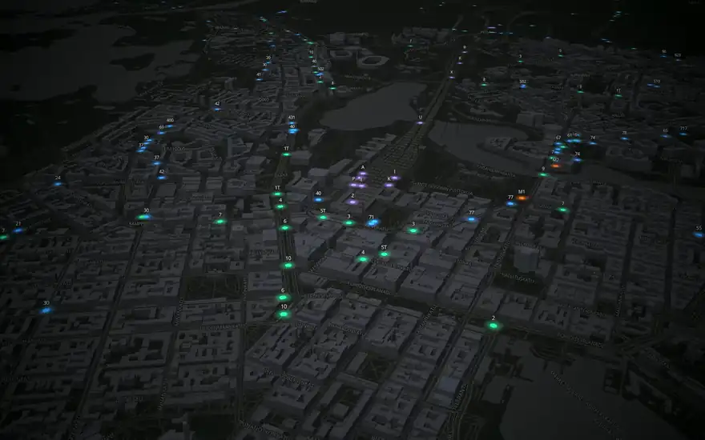

# Helsinki Live

Every HSL bus, tram, metro, train and ferry, moving live on a 3D map of Helsinki.

**Try it:** https://magnus.is-a.dev/helsinki-live/

[](https://magnus.is-a.dev/helsinki-live/)

Click a vehicle to follow it, switch modes on and off, colour the whole city by delay, or type a line number to find it.

## How it works

```
HSL broker (MQTT over WebSocket)
   │  ~800 position messages a second
   ▼
mqtt.ts      PacketReader splits the byte stream into packets → PUBLISH → topic + payload
   ▼
hfp.ts       topic + JSON payload → VehicleUpdate (mode, line, headsign, position, delay)
   ▼
vehicles.ts  VehicleStore: glide from the on-screen position to each new fix, snap on GPS jumps,
             forget vehicles that go quiet, aggregate stats
   ▼
map.ts       MapLibre (WebGL): GeoJSON source redrawn ~20 times a second, 3D buildings
   ▼
App.tsx      React panels that refresh twice a second, so the map stays smooth
```

- **A small MQTT client instead of a library.** Reading HSL's feed only needs CONNECT, SUBSCRIBE, PUBLISH and PING, so [`src/lib/mqtt.ts`](src/lib/mqtt.ts) implements just those in about 200 lines. The tricky part is the stream: one WebSocket frame can carry several packets or half of one, including a split in the middle of the variable-length size field. The tests cover each case byte for byte.
- **Smooth movement.** Vehicles report about once a second. Each one eases from where it currently is on screen to its new position over that second, so motion looks continuous. A jump of more than 800 m (a GPS glitch or a new journey) snaps instead of sliding across town.
- **Delays the right way round.** HFP's `dl` is the offset from the timetable, where negative means behind schedule. It's converted once, at the edge, into `secondsLate`, and "unknown" is kept separate from "on time".
- **Careful with data.** Each mode is its own topic subscription, so switching a mode off stops that traffic at the broker. The feed pauses when the tab is hidden or after five idle minutes, and phones start without buses, which are over half the messages.

## Stack

TypeScript, React 19, Vite, Tailwind CSS v4, MapLibre GL, Vitest. Map tiles from OpenFreeMap (no API key).

## Run it

```bash
npm install
npm run dev      # http://localhost:5173/helsinki-live/
npm test         # 20 tests: parser, MQTT framing, interpolation, stats
npm run verify   # typecheck + tests + production build
```

Every push to `main` runs `npm run verify` in GitHub Actions, and the site only deploys if it passes.

## Credits

Vehicle positions: [HSL high-frequency positioning](https://digitransit.fi/en/developers/apis/5-realtime-api/vehicle-positions/), Helsinki Region Transport, CC BY 4.0. Map data © OpenStreetMap contributors via [OpenFreeMap](https://openfreemap.org).

Built by [Magnus Kaur](https://magnus.is-a.dev).

**Sound:** the same generative ambient music as [magnus.is-a.dev](https://magnus.is-a.dev), synthesised with the Web Audio API (no audio files). The portfolio and its Lab projects share one origin, so the on/off choice follows you between them.
